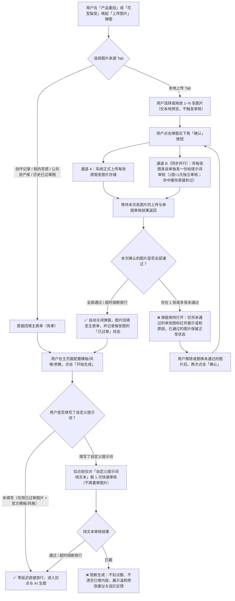

# 三笙AI 工具箱「产品重拍」与「花型裂变」内容安全审核功能 · 产品需求文档（PRD）

| 文档信息 | 内容 |
| :--- | :--- |
| **文档版本** | `v2.2`（产品评审版） |
| **撰写角色** | 产品经理 |
| **所属产品** | 三笙AI（PC 端 / Web 端工具箱） |
| **涉及模块** | **产品重拍**、**花型裂变**、**「上传图片」通用弹窗**、**内容安全审核管理后台** |
| **目标读者** | 产品、UI/UX 设计、前端、后端、算法/风控、测试（QA）、运营 |
| **更新日期** | `2026-11-19` |

### 修订记录
| 版本 | 日期 | 修订说明 |
| :--- | :--- | :--- |
| `v1.0` | 2026-11-19 | 初稿：明确产品重拍与花型裂变接入审核的整体方案与成本测算 |
| `v2.0` | 2026-11-19 | 重构为标准产品经理 PRD：补充前台状态机、温和文案规范、9 大风控规则与 UAT 清单 |
| `v2.1` | 2026-11-19 | 对齐三笙「上传图片」弹窗交互与 6 大来源 Tab 策略 |
| `v2.2` | 2026-11-19 | **核心机制修正**：明确改为 **「每张图单独审 1 次」** + **「本地上传点击确认时，系统上传图片与发送提示词审核并行执行」**；点击生成时不再重复打包重审图片，仅对用户自定义输入的纯文本提示词做快速审核 |

---

## 一、需求背景与产品目标

### 1.1 业务痛点
三笙AI 工具箱的 **「产品重拍」** 与 **「花型裂变」** 是家纺及全品类商家高频使用的核心 AI 生图工具。当前用户在「上传图片」弹窗上传商品原图、参考图或花型母图后，缺乏前置内容安全与提示词审核机制，带来三类直接业务风险：
1. **版权侵权投诉风险（高发）**：商家在「花型裂变」中上传含知名动漫/影视版权角色（如迪士尼、漫威、宝可梦等）的花型母图，或在「产品重拍」中试图生成带侵权 IP 元素的商拍图，易引发平台版权连带责任。
2. **内容合规与平台安全红线**：在「产品重拍」（尤其是贴身服饰、内衣、真人互动场景）中，个别用户上传违规图片或输入擦边/露骨脱衣指令、敏感涉政内容或辱骂暴力标语，触碰监管红线。
3. **算力损耗与糟糕的用户体验**：违规素材直接进入生图队列后，要么被上游生图模型拒画导致**无效算力损耗与点数退还纠纷**，要么让用户在选完模板、调完 2K/4K 参数、点生成后才发现失败，严重损害体验。

### 1.2 产品核心目标（KPI）
本次需求旨在**不伤害正常商拍体验、不拖慢上传与生图主流程**的前提下，建立 **「本地上传确认时单图并行独立审核 + 自定义提示词纯文本快审」** 的前置安全防线：

| 指标维度 | 目标值 | 说明 |
| :--- | :--- | :--- |
| **高危违规拦截率** | `≥ 98%` | 覆盖版权 IP、色情擦边、中国涉政、针对性辱骂与暴力煽动 |
| **正常商拍误拦率** | `< 1%` | 正常家纺/床品、合规内衣平铺展示、传统文化纹样不得误拦 |
| **单图并行审核耗时** | `P95 ≤ 4.0 秒` | 与图片上传动作**同时发起、耗时重叠**，最大程度降低用户额外等待 |
| **主流程可用性** | `≥ 99.9%` | 审核服务异常或超时自动熔断放行，绝不卡死上传与生图主流程 |
| **单张图片审核成本** | `~ ¥0.0019 / 张` | 每张新图独立审 1 次；已过审图片复用记录免重复审，平台内白名单资产免审 |

---

## 二、适用范围与核心业务流程

### 2.1 「上传图片」弹窗 6 大来源 Tab 审核策略

三笙工具箱「产品重拍」与「花型裂变」共用统一的 **「上传图片」弹窗**（含 6 个图片来源 Tab）。为了**只审外部新上传的图片、避免重复计费**，按来源差异化制定规则：

| 「上传图片」弹窗 Tab | 业务属性 | 是否触发审核 | 策略说明 |
| :--- | :--- | :---: | :--- |
| **本地上传** | 用户从本地电脑选择/拖放 1~N 张图片（PNG/JPG/JPEG/WEBP/BMP/HEIC/HEIF，单张最大 800M） | **✅ 必审（点击「确认」时每张图单独审 1 次）** | 选图/拖入预览阶段不触发；点击右下角 **「确认」** 后，**系统上传图片的同时，同步将每张图片单独发送一份给提示词审核服务** |
| **历史上传** | 用户过往上传到平台的图片 | **⚡ 读取单图已过审状态** | 每张图在首次上传确认时已独立审核并绑定状态；再次从历史上传选用时直接放行免审（上线前存量老图可按开关决定是否补审 1 次后永久打标） |
| **创作记录** | 平台内已生成的历史成片 | **⏭️ 白名单免审** | 平台内生图资产默认免审 |
| **我的收藏** | 用户收藏的平台资产 | **⏭️ 白名单免审** | 平台资产免审（外部导入图按历史上传状态复用） |
| **我的灵感** | 平台灵感库内容 | **⏭️ 白名单免审** | 平台合规内容库免审 |
| **公共资产库** | 官方公共素材/模板 | **⏭️ 白名单免审** | 官方白名单资产免审 |

此外，在业务功能层面：
- **产品重拍**：用户在「上传商品原图（1–3 张）」或「上传参考图」时，每张本地上传确认的图片**各自单独审 1 次**；**官方模板库**（如「白栀漫野」）与**官方场景风格**走白名单免审。
- **花型裂变**：用户本地上传确认的花型母图**单独审 1 次**；无论后续一次裂变 4 张还是 8 张，**均不再重复审图**。

### 2.2 核心业务流程：「点击确认上传与单图审核并行」

> [!IMPORTANT]
> **核心产品逻辑：每张图单独审 1 次，且与图片上传并行执行！**
> 1. **选图阶段零打扰、零计费**：用户在「本地上传」Tab 点击选择或拖放多张图片、删掉重选时，**不触发审核**；
> 2. **点击「确认」双线并行**：用户点击右下角 **「确认」** 后，系统开始正式上传图片的同时，**将每一张图片各自单独发送一份给提示词审核服务**（例如选了 3 张图，就并发发起 3 次独立的单图审核）；
> 3. **单图精准处置、互不牵连**：每张图独立返回结果。全部通过则关闭弹窗回填主表单；若某 1 张不通过，仅拦截/标红那 1 张图，其余已通过的图正常保留，不需要全部重传重审；
> 4. **点击生成时不再重审图片**：已通过审核的图片直接放行；仅当用户额外手动输入了自定义提示词时，在扣点前对该段纯文本做 1 次极速纯文本审核。

---

## 三、功能需求详述

### 3.1 前台用户端交互规范（「上传图片」弹窗 & 生图主界面）

#### 1. 「上传图片」弹窗（本地上传 Tab）交互状态机
用户在「产品重拍」或「花型裂变」打开「上传图片」弹窗，在 **「本地上传」** Tab 操作时的完整状态定义：

| 弹窗阶段 | 按钮与界面表现 | 交互规则 |
| :--- | :--- | :--- |
| **① 未选图 / 初始态** | 展示上传区（支持 PNG/JPG/JPEG/WEBP/BMP/HEIC/HEIF，单张最大 800M）；右下角「确认」按钮置灰不可点 | 不触发上传，不触发审核 |
| **② 已选图待确认态** | 展示已选中的 1~N 张图片缩略图（支持继续拖入或点击删除单张）；右下角「确认」按钮高亮可点 | **此阶段仅本地预览，不触发任何审核**，避免误选产生无效计费 |
| **③ 点击「确认」· 上传与审核并行中** | 「确认」按钮变为 Loading 态 **`上传并检测中...`** 并禁用；顶部 Tab 切换与图片增删暂时锁定；每张图片缩略图展示轻量进度/检测态 | **系统上传图片的同时，同步将每张图片各自单独发送 1 份给提示词审核服务**；若某张图命中 24h 已过审缓存则直接秒过，不重复计费 |
| **④ 全部通过** | 弹窗自动关闭，所有图片按原顺序回填到「产品重拍」或「花型裂变」主表单，同时每张图在「历史上传」中记录为「已过审」状态 | 静默无打扰，用户直接继续选模板/风格/参数 |
| **⑤ 某张 / 部分图片未通过** | **弹窗保持打开不关闭**！未通过检测的那张图片缩略图边框变**警示红**，覆盖半透明蒙层与角标「`暂不支持`」，展示温和原因提示 + **「删除」/「替换」**快捷操作 + 「判定有误？点击反馈」入口；**同批其他已通过的图片保持绿标/正常保留态** | 1. 存在标红未通过图片时，不允许把该违规图带入主表单； 2. 用户删除或替换违规图后再次点「确认」时，**刚才已上传且已通过的图片无需重新上传、无需重新审核**，直接复用结果，仅处理新替换的图 |

#### 2. 主界面点击「开始生成」时的交互规则
- **无自定义提示词**：因为图片均已在弹窗点击「确认」时完成单图独立审核（或来自白名单 Tab），点击「开始生成」**零等待直接进入扣点与生图**。
- **有自定义提示词**：扣点前仅对用户输入的**纯文本提示词**发起 1 次快速审核（约 0.5–1 秒），按钮短暂显示「`安全检测中...`」。若被拦截，在生成按钮上方展示内联警示卡片，**严禁扣除用户点数、严禁清空已传图片和已输入提示词**。

#### 3. 用户端温和提示文案规范（面向商家）
> [!TIP]
> **文案设计原则**：态度友好、给出明确可执行的修改方向，**绝不向用户暴露内部规则编号、概率分值或底层模型名称**，避免被恶意试探与绕过。

| 触发风险类型 | 弹窗内单图缩略图短提示 | 详情引导文案（弹窗底部 / 生成前提示条） |
| :--- | :--- | :--- |
| **版权 IP 侵权** | `图片可能涉及版权形象` | 当前素材或描述可能涉及受保护的版权形象/品牌元素，暂不支持使用。请删除该图并替换为原创素材，或移除相关形象名称后重试。 |
| **色情 / 擦边低俗** | `图片不符合内容规范` | 当前素材或描述包含不符合平台内容规范的画面/词汇，请更换得体的商品展示图或调整描述后重试。 |
| **涉政 / 暴力违法** | `内容不符合安全规范` | 当前素材或描述不符合平台安全合规要求，请更换素材或修改相关文字后重试。 |
| **通用兜底文案** | `暂不支持使用` | 当前素材或描述未通过内容安全检测，请更换图片或调整描述后重试。 |

- **误拦反馈入口（必配）**：所有拦截提示旁均附带轻量入口 **「判定有误？点击反馈」**，点击即可一键上报本次单图/提示词审核单号给运营复核，提交后提示 *「已收到反馈，风控团队将在核实后优化」*。

---

### 3.2 内容安全审核策略与风控处置规则（对齐 `content-policy-v3`）

每张图片的独立审核以及纯文本提示词审核，均遵循统一的风控维度与商拍豁免边界：

| 风险类别 | 审核覆盖范围与典型拦截场景 | 处置动作 | 商拍专属豁免边界（绝不误拦） |
| :--- | :--- | :---: | :--- |
| **1. 版权 IP 侵权 (`IP-001`)** | 含知名受版权保护的卡通/动漫/游戏/潮玩/品牌形象（如迪士尼草莓熊、玲娜贝儿、漫威、宝可梦、Hello Kitty、Labubu 等，含别名与改色模仿） | **直接拦截** | 通用自然元素（普通小熊、碎花、通用机甲）、以及**明确否定排除**写法（如“不要米老鼠元素”）→ **放行** |
| **2. 露骨色情 (`SEX-001`)** | 裸露性器官、性行为、明确脱衣/透视露点画面或指令 | **直接拦截** | 泳装/内衣正常商拍展示、医学科普中性表述、否定排除 → **放行** |
| **3. 擦边性暗示 (`SEX-002`)** | 刻意突出性特征、情趣挑逗姿态、低俗性暗示词或故意走光视角 | **直接拦截** | **正常内衣/睡衣/泳衣平铺图、人台图及得体的常规电商模特穿搭展示** → **放行** |
| **4. 中国涉政敏感 (`CN-POL-001`)** | 涉及中国（含港澳台）领导人及谐音影射、党政军机关、国旗党徽标识、敏感历史/领土/抗议议题 | **直接拦截** | 正常中国传统文化、非遗纹样、故宫/江南古建风景、传统节日与诗词 → **放行** |
| **5. 外国涉政话题 (`TOPIC-001`)** | 涉及外国政治人物、政党、政府机构、竞选或国际政治事件 | **仅打标·放行** | 后台留存风险标签便于运营抽检，默认不阻断用户上传与生成 |
| **6. 针对性辱骂 (`ABUSE-001`)** | 对特定个人或群体进行直接辱骂、羞辱或恶意贬低 | **直接拦截** | 客观引用转述、正常商品卖点修饰词 → **放行** |
| **7. 指定对象侮辱 (`SUBJECT-001`)** | 对后台登记在保护名单内的特定对象进行侮辱或恶意丑化 | **按名单拦截** | 未配置保护名单时自动跳过（不误拦） |
| **8. 暴力煽动 (`VIO-001`)** | 号召、鼓励或威胁对他人或特定地点实施暴力袭击 | **直接拦截** | 新闻历史叙述、影视虚构场景或明确反对暴力的表述 → **放行** |
| **9. 证据充分 (`QUALITY-001`)** | 仅评估文字是否完整可读、图片是否清晰可辨（质量信号，不判违规） | **质量参考** | 仅用于判断清晰度，避免极度模糊/乱码导致误判 |

---

### 3.3 高可用兜底与超时熔断规则（核心产品保障）

为确保内容安全审核**绝对不卡死图片上传与 AI 生图主流程**，产品层面明确以下 3 条高可用铁律：
1. **多通道自动级联兜底**：后台可配置多个审核通道及优先级顺位；当第 1 顺位通道报错、限流或超时时，系统毫秒级自动切换至下一顺位通道继续检测，对用户完全无感。
2. **总耗时上限熔断放行**：单张图片/单次纯文本审核设定严格的总等待上限（默认 **10–12 秒**，后台可配）。若达到上限仍未拿到结果，系统立即**终止等待并自动降级放行**，同时后台打标“超时放行”供事后抽检，绝不让用户无限转圈。
3. **功能级一键降级开关**：产品重拍、花型裂变各自拥有独立的审核模式开关（`全量拦截` / `旁路仅记录不拦截` / `紧急关闭`），极端故障时运营可在 10 秒内止损。

---

### 3.4 运营与风控管理后台需求

面向运营、产品及风控人员，审核管理后台需具备以下 4 项核心能力：
1. **规则阈值动态配置**：支持对 9 条规则独立调整严格度阈值（0%–100%）与启停开关，修改实时生效，无需发版。
2. **审核通道与兜底顺位管理**：可视化配置图片审核通道、纯文本审核通道的优先级顺位、单通道超时时间及总耗时熔断上限。
3. **审核审计日志与误拦工单复核**：
   - 支持按时间、功能来源（产品重拍/花型裂变）、审核类型（单图审核/纯文本审核）、处置结果（通过/拦截/超时放行）、触发规则、用户反馈状态筛选查询；
   - 查看每条记录的原始图片缩略图/提示词、命中原因、耗时及兜底日志；
   - 支持对用户误拦反馈执行 **「人工终裁（改判为合规 / 维持拦截）」**，沉淀案例库持续反哺准确率。
4. **核心风控与成本看板**：实时展示当日单图审核量、纯文本审核量、缓存命中率、拦截率、各规则命中占比、误拦申诉率、平均耗时及预估日成本。

---

## 四、非功能需求与边界场景处理

1. **点数资金安全（硬性红线）**：无论是「本地上传」点击确认时的单图审核，还是点击生成前的纯文本审核，**均发生在扣点逻辑之前**，确保用户 **0 误扣点**。
2. **800M 超大图与多格式兼容**：本地上传支持单张最大 `800M` 及 `PNG/JPG/JPEG/WEBP/BMP/HEIC/HEIF` 格式。在点击「确认」同步发送给提示词审核时，**发送压缩后的标准预览副本**（统一转为 JPEG、长边压缩至 `≤ 1024px`），同时主通道正常上传高清原图，既**不影响 2K/4K 高清生图质量**，又确保审核速度快、不因原图过大而超时。
3. **多图并行与局部失败处理**：
   - 一次选择 3 张本地图片点击「确认」时，3 张图**各自独立并发上传 + 各自独立并发审核**，总耗时约等于最慢那 1 张的耗时；
   - 若某张图审核未通过，该图不入「历史上传」资产库（或标记为不可用），避免后续误选；已通过的图片正常保留。
   - 若用户点击「确认」检测期间发生弱网断连，提示“网络异常，请重试确认”并恢复按钮可点，不清空已选图片。
4. **数据隐私与留存周期**：审核日志中的用户图片与提示词仅用于安全审计与误拦复核，严格做好权限脱敏，并按平台隐私规范定期自动清理过期审计图片（如 30 天）。

---

## 五、成本测算与降本预期

基于 2026-11-19 真实审核账单实测口径，按 **「每张本地新图单独审 1 次 + 平台内资产/历史已过审图免审 + 自定义提示词纯文本快审」** 测算：

| 审核类型 | 触发条件 | 单次未命中缓存预估成本 | 降本复用说明 |
| :--- | :--- | :---: | :--- |
| **单张图片独立审核** | 「本地上传」点击「确认」时，每张新图独立审 1 次 | `~ ¥0.0019 / 张`（平均耗时 `~3.4s`，与上传并行重叠） | 同一张图绑定已过审状态，从「历史上传」复选、或删除后 24h 内重复上传均 **¥0 秒过**；平台内 4 大资产 Tab 与官方模板全部免审 |
| **纯文本提示词快审** | 点击「开始生成」前，仅当用户填写了自定义提示词时审 1 次 | `¥0.0001 ~ ¥0.0014 / 次`（平均耗时 `< 1.0s`） | 未填写自定义提示词时直接 **¥0 跳过**；批量花型裂变（4 张/8 张）仅审 1 次 |

---

## 六、数据埋点与灰度上线计划

### 6.1 核心数据埋点清单
| 事件名称 | 触发时机 | 核心关注属性 |
| :--- | :--- | :--- |
| `review_local_confirm_start` | 「本地上传」Tab 点击「确认」，发起上传与单图并行审核 | 功能名（产品重拍/花型裂变）、本次确认张数、命中缓存张数 |
| `review_single_image_result` | 每张图片的独立审核返回结果 | 功能名、判定结果（通过/拦截/超时放行）、触发主规则、单图审核耗时（ms） |
| `review_local_replace_retry` | 弹窗内某图被标红拦截后，用户删改并再次点「确认」 | 功能名、原触发规则（衡量拦截后的挽回率） |
| `review_text_submit_result` | 点击「开始生成」前纯文本提示词审核返回 | 功能名、判定结果、触发规则、耗时（ms） |
| `review_appeal_click` | 用户点击「判定有误？点击反馈」 | 审核单号、审核类型（单图/纯文本）、触发规则（衡量真实误拦率） |

### 6.2 三阶段灰度发布策略
1. **阶段一：旁路观察期（3 天，100% 流量仅记录不拦截）**
   - 线上真实本地上传单图与自定义提示词全部走一遍审核，但不阻断用户；
   - 产品与运营每日抽检 100 条高风险命中样本，校准 9 条规则阈值，确认正常商拍误拦率 `< 1%`。
2. **阶段二：小流量拦截期（3 天，20% 流量开启真实拦截）**
   - 放开 20% 用户的弹窗单图标红拦截与生成前纯文本拦截；重点监控替换重试率、客服反馈、误拦申诉率及并行耗时体验。
3. **阶段三：全量上线（100% 流量开启）**
   - 全量生效，转入日常看板巡检与每周误拦工单复盘机制。

---

## 七、产品验收标准（UAT 核心清单）

| 序号 | 验收场景 | 操作步骤 | 预期结果 |
| :---: | :--- | :--- | :--- |
| 1 | **选图预览不触发审核** | 打开「上传图片」弹窗，在「本地上传」拖入 2 张图片，删掉 1 张后关闭弹窗（未点「确认」） | 后台**不产生**任何审核调用与费用消耗 |
| 2 | **单图独立并行审核（全部通过）** | 在「产品重拍」本地选择 3 张正常四件套原图（含 1 张大体积 HEIC 图），点击「确认」 | 后台并发产生 **3 条独立的单图审核记录**（与上传并行执行）；全部通过后弹窗自动关闭，3 张图回填主表单 |
| 3 | **单图独立并行审核（部分拦截）** | 在「产品重拍」本地选择 2 张正常床品图 + 1 张迪士尼草莓熊版权图，点击「确认」 | **弹窗不关闭**；仅草莓熊图标红提示「暂不支持」，其余 2 张正常图保留通过态；删除草莓熊图再点「确认」，2 张正常图无需重传重审直接关闭弹窗 |
| 4 | **平台内白名单与历史图免审** | 切换到「历史上传（已过审图）」「创作记录」「我的灵感」「公共资产库」选图并点击「确认」 | 秒级回填主表单，不触发重复审核调用 |
| 5 | **正常内衣商拍豁免** | 在「产品重拍」本地上传正常得体的内衣/睡衣平铺图，点击「确认」 | 单图审核正常通过并关闭弹窗，不发生误拦 |
| 6 | **纯文本提示词快审与防扣点** | 合规图片回填后，输入色情擦边或涉政补充提示词，点击「开始生成」 | 仅对纯文本提示词做审核（不重审图片），扣点前拦截并展示温和建议与反馈入口；**点数余额未减少，已传图片与文字未清空** |
| 7 | **批量裂变不重复审图** | 在「花型裂变」本地上传合规母图点击「确认」通过后，选择一次裂变 8 张并提交 | 仅在点击「确认」时对该母图审了 1 次，生成 8 张时不再重审图片 |
| 8 | **异常兜底与超时熔断** | 模拟单图审核主通道故障或全通道超时（超过设定上限） | 自动切换兜底通道；全超时则达到上限后自动降级放行关闭弹窗，上传与生图主流程不卡死 |
